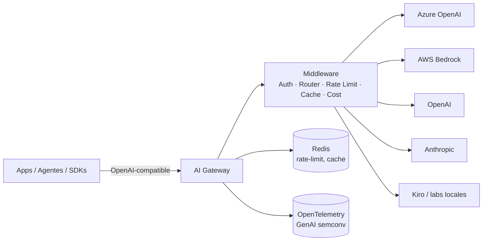

# AI Gateway

> Gateway empresarial de LLMs: una API **única y estable** (OpenAI/Anthropic-compatible) sobre múltiples proveedores (Azure, AWS Bedrock, OpenAI, Anthropic, y labs locales como Kiro). Ruteo inteligente, fallbacks, rate limiting, caché y control de costos.

[](LICENSE)
[](CONTRIBUTING.md)
[](https://python.org)

## ¿Por qué un gateway de IA?

Las apps que llaman modelos directamente se atan a un proveedor y pierden viento de cola:

- **Cambiar de proveedor** = reescribir integraciones.
- **Sin fallback**: una caída de un proveedor tumba la app.
- **Sin gobierno**: costos sin control, sin límites, sin trazabilidad.
- **Sin portabilidad**: cada equipo reinventa la rueda.

Un gateway centraliza **autenticación, ruteo, resiliencia, observabilidad y FinOps** del consumo de modelos.

## Arquitectura



## Estructura

```
ai-gateway/
├── config/
│   ├── gateway.yaml          # políticas de ruteo y límites
│   └── models.yaml           # catálogo de modelos y sus proveedores
├── src/gateway/
│   ├── main.py               # app FastAPI (endpoints /v1)
│   ├── core/
│   │   └── router.py         # selección de proveedor + fallback
│   ├── providers/            # adaptadores por proveedor
│   │   ├── base.py
│   │   ├── openai_provider.py
│   │   ├── anthropic_provider.py
│   │   ├── azure_provider.py
│   │   ├── aws_bedrock_provider.py
│   │   └── kiro_provider.py
│   └── middleware/           # auth, rate-limit, cache, cost
├── tests/
├── docker-compose.yml        # gateway + redis
├── .env.example
└── requirements.txt
```

## Quickstart

```bash
cp .env.example .env      # agrega tus API keys
pip install -r requirements.txt
uvicorn src.gateway.main:app --port 8000

curl http://localhost:8000/v1/chat/completions \
  -H "Authorization: Bearer $GW_KEY" \
  -H "Content-Type: application/json" \
  -d '{ "model": "claude-sonnet-4.5", "messages": [{"role":"user","content":"Hola"}] }'
```

La app ignora lógica de proveedor; solo se configura (ver [docs/routing-strategies.md](docs/routing-strategies.md)).

## Decisiones clave (ADR)

| ADR | Decisión |
|-----|----------|
| [ADR-0001](docs/ADR-0001-unified-llm-api.md) | API unificada para desacoplar apps del proveedor |

## Licencia

MIT — ver [LICENSE](LICENSE).