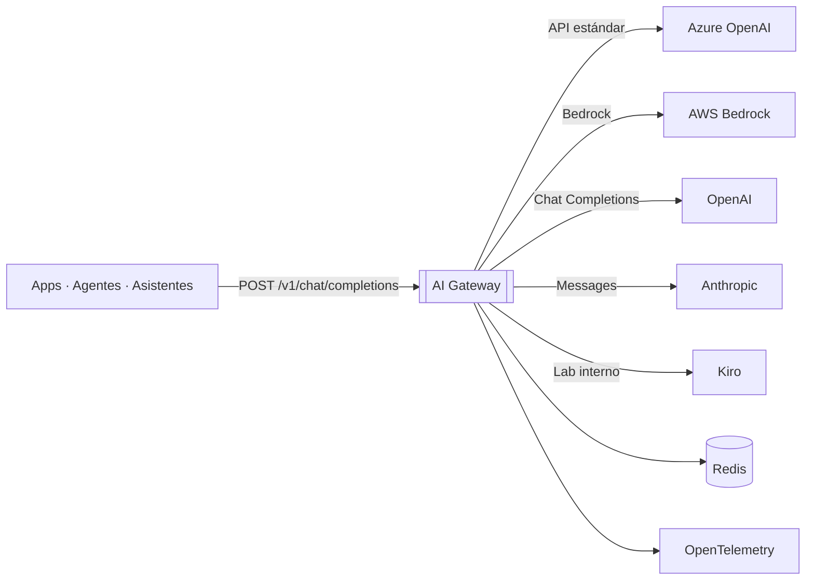
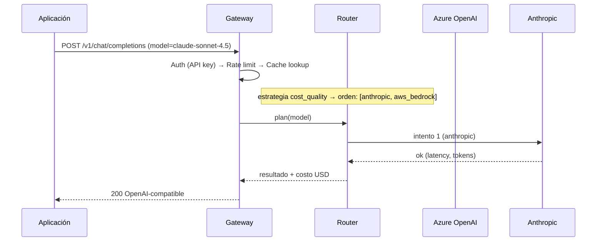

# Arquitectura del AI Gateway

## Contexto (C4)

## Flujo de una petición

## Componentes (C3)

| Componente | Responsabilidad |
|------------|-----------------|
| `main.py` | Contrato HTTP único / modelo de transporte |
| `core/router.py` | Estrategia de ruteo, fallback y cuarentena |
| `providers/*` | Adaptadores (Ports & Adapters sobre el consumo de LLMs) |
| `middleware/rate_limit` | Ventana deslizante Redis |
| `middleware/cache` | Deduplicación de costo por petición |
| `middleware/cost` | Ledger FinOps (USD por modelo/cliente) |
| `middleware/auth` | API keys y (futuro) OAuth2 / Entra ID |

## Características transversales

- **Trazabilidad**: OpenTelemetry con [semconv GenAI](https://opentelemetry.io/docs/specs/semconv/gen-ai/) (span por provider, tokens, costo).
- **Seguridad**: nunca se exponen las claves de proveedores; el gateway es el único puerto.
- **Gobernanza**: el catálogo de modelos está en `config/models.yaml` (versionado, revisado en PR).